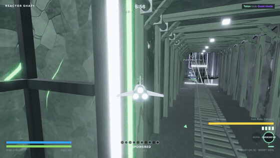

# Project Orange

**A zero-install 6DOF arena shooter that lives in a browser tab.** Fly one of
four ships through an abandoned asteroid mine, shoot your friends, collect the
oranges they drop, get terrifying, get hunted. Matches fill with bots so
there's always someone to shoot.

> 🚧 **Pre-release** — public play at [projectorange.nexus](https://projectorange.nexus)
> is coming. Until then, the game runs from this repo in two commands (below).
> Watch releases for the launch.



**Watch the [30-second gameplay video](assets/launch/gameplay-30s.mp4)** (720p,
60 fps). The footage shows Dart in Hollowdeep Mine, Mule in The Gyre, Scythe
in Meridian Tower, and Brute in Gloamwood, all with the in-game HUD.

## The loop

Kill → they spill **oranges** → grab them → your power climbs for this life →
weapons, shields, an alternate fire mode, the **Repel** shockwave → and the
more powered-up you are, the more you're worth when someone finally gets you:
dying drops half your power for them to steal. Snowballing is a target on your
back.

## What's in the box

- **Four original ships** with distinct flight and counterplay identities
- **Four maps**: Hollowdeep (the working mine), The Gyre (moving machinery),
  Meridian Tower (orange-stuffed high-rise shafts), and Gloamwood (a giant
  forest around a spire), rotating per match
- **Bots that backfill** every match — full game offline, no server needed
- **Rooms 2–8, join by link**, private rooms, quickmatch fills the fullest room
- **Powerups** rotating every 30 seconds per map
- **Under 5 MB** initial download — ships and arena are generated in code, not assets
- Deterministic shared sim (Rapier) — the same physics on client, server, and bots

## Run it locally

```bash
pnpm install
pnpm dev          # client at the printed URL (offline vs bots works with no server)
pnpm dev:server   # optional: local room server for multiplayer
pnpm test         # unit tests
pnpm soak         # sim soak: headless rooms-per-process measurement
pnpm balance brute hull=220   # paired bot-vs-bot A/B sims of a tuning change
pnpm repro practice-smoke     # headless Chromium plays a scripted client scenario
```

Requires a recent Node LTS. The client is desktop Chrome/Edge/Firefox/Safari
with keyboard+mouse, pointer lock, and gamepad.

## How it's made

Every ship, every rock, every map is **built procedurally in code** — no model
files, which is why the whole game fits in a browser's first five seconds.
Long-form build notes live in `ProjectOrange_Browser_Design.md` (the full
design document, tuning numbers and all) — and a public notes page ships with
the launch.

## Contributing

Issues, bug reports, and **balance requests** are welcome — balance requests
should cite numbers (your ship, the matchup, what happened vs. what you
expected). Good balance claims get replayed through the headless bot-vs-bot
sim before anyone argues about them: `/balance brute hull=220` on an issue posts
the paired A/B table ([how it works](docs/balance-bot.md)), and `pnpm balance`
runs the same thing locally. Client bugs with repro steps can be replayed
headlessly with `pnpm repro` ([scenarios](packages/client/repro/README.md)). Issue templates are in `.github/` (as the
public factory comes online). The repo's task board is
[Dolt-backed](.beads/README.md) — `bd bootstrap` after cloning to see open work.

## License

MIT — see [LICENSE](LICENSE). Third-party attribution in
[NOTICES.md](NOTICES.md).
